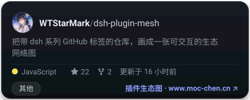

# 插件生态图

插件生态图是一个网页：把 GitHub 上带 `dsh` 系列标签的仓库，按功能画成一张可交互的关系图。圆心固定是官方仓库 `deepseek-ai/deepseek-harness`，往外分成 21 个功能扇区（扇区就是功能分区），数据每小时自动更新。

[](https://www.moc-chen.cn/)
[](#测试与-ci)
[](#技术选型)
[]()

在线地址：<https://www.moc-chen.cn/>

<picture>
  <source media="(prefers-color-scheme: dark)" srcset="https://www.moc-chen.cn/preview.svg?theme=dark&size=1400&sample=6000">
  <source media="(prefers-color-scheme: light)" srcset="https://www.moc-chen.cn/preview.svg?theme=light&size=1400&sample=6000">
  
</picture>

> 预览图由站点实时渲染（`/preview.svg?theme=dark|light`），读 `data/mesh-core.json`，随采集更新。地址里的 `size` / `sample` 可省：不带参数时默认 1400px / 6000 球；字号、图例、球半径都会随画布等比缩放，所以任何尺寸出的都是同一张图的不同分辨率。

**页面本身没有明暗开关。** 顶栏只有「清爽 / 粉黛」两套配色键，`<html data-theme="light">` 固定浅色。`src/palettes.js` 里的深色变体仍然保留，但只服务于上面这张预览图（以及 `docs/preview.svg`、`docs/preview-light.svg` 两个离线副本）——预览图按读者的系统明暗偏好选色，页面上切不到深色。

本项目是独立站点：静态前端 + Python 采集后端 + 同端口的只读查询 API。不依赖 DSH 运行时，也不是 DSH 插件。

## 能干什么

| 能力 | 说明 |
|---|---|
| 生态全景 | 21 个功能扇区按星标从内到外排布；坐标由可播种随机数生成，同一 seed 可复现 |
| 单扇区放大 | 点扇区，它铺满整圆，圆内按细枝（更细的功能分组）重新分区；`Esc` 或左栏「返回全景」退出 |
| 双击聚焦 | 双击一个仓库，以它为中心重建扇形图；双击官方仓库直接回全景 |
| 生态榜单 | 顶栏奖杯弹窗两个榜，各最多 50 行：周更新热榜（本周真发过 release 的项目）与周 star 热榜 |
| 搜索与筛选 | 搜仓库名 / 作者 / 描述 / topics，README 正文走后端检索；筛选只淡化、不改变位置 |
| 三类连线 | 同作者（完整关系）、主题共现（琥珀虚线）、生态共鸣（紫罗兰实线，基座 → 插件） |
| 管理后台 | 与站点同进程同端口，六个标签页；改完黑名单或共鸣清单点「应用变更」离线重建 |
| 数据出口 | 只读查询 API + 每个仓库一张自包含 SVG 卡片 |

## 本地跑起来

只需要 Node ≥ 22（见 `package.json` 的 `engines`）和 Python 3，没有第三方依赖：

```bash
git clone https://github.com/WTStarMark/dsh-plugin-mesh && cd dsh-plugin-mesh
python3 backend/collect.py --from-raw   # 用仓库自带的样本离线算一份前端数据（不联网、不耗配额）
npm run serve                           # 打开 http://127.0.0.1:8788/
```

想让局域网里的设备访问用 `npm run serve:lan`；换端口用 `PORT=9000 npm run serve`。

真实采集需要 GitHub 令牌（只读公开数据，见下一节）：

```bash
cp .env.example .env                                # 填入 GITHUB_TOKEN=...
python3 backend/collect.py --once                   # 跑一轮真实采集
python3 backend/collect.py --loop --interval 3600   # 常驻，每小时一轮
python3 backend/collect.py --from-store             # 改完规则后离线重算（不联网、不耗配额）
```

运行数据（`data/mesh.json`、`data/mesh-core.*`、`data/cache/` 等）体积大，且每小时都变，所以不入库。它们由部署机上的采集器生成。干净克隆先跑一次 `--from-raw`，就有一份可看可测的数据。

两点注意：

- pm2 下必须用 `--loop`：pm2 会把 `--watch` 认成它自己的文件监听开关。
- 改完分类或相关性规则要重启常驻采集器：规则表在进程启动时导入。不重启的话，下一轮会用旧规则把契约覆盖回去。`pm2 restart dsh-mesh-collector` 之后它会立刻按新规则跑一轮。

## GitHub 令牌

不配也能跑，只是配额低：匿名搜索 10 次/分。配上令牌升到 30 次/分、core 5000 次/时。令牌只读公开数据，不需要任何仓库权限。

```bash
cp .env.example .env             # 填 GITHUB_TOKEN=...（fine-grained token：仓库访问选 Public Repositories，权限全不勾）
python3 backend/check_token.py   # 自检：只打印配额数字，不打印令牌
```

## 数据从哪来

采集器是一个 Python 脚本，只用标准库，不做模型调用：

```
GitHub 搜索 API
  └─ 分段扫描（segments.py）
       ├─ 把抓取空间切成「标签 × 星标区间」的小段
       ├─ 一段超过 1000 条（接口上限）就按创建时间继续细分：年 → 季度 → 月 → 半月 → 日
       ├─ 每轮只刷新最久没动的一批（默认预算 120 次搜索请求）
       ├─ 命中噪声黑名单的作者直接跳过，不消耗配额、不进索引
       └─ 结果并入累积索引 data/cache/repos.json，跨轮次累加
  └─ 构建（build.py）
       ├─ 噪声判定、相关性三档结论、功能分类
       ├─ 同作者 / 主题共现 / 生态共鸣三类连线
       └─ 产出 data/mesh.json + data/snapshots/<时间戳>.json + data/last-crawl.json
```

**收录口径**：只收「有信号」的仓库，也就是至少一个白名单 topic，或一句 ≥10 字的描述。只有名字带 dsh、既没描述也没 topic 的空壳不入库。数量记在 `meta.noSignalSkipped`。

**白名单标签**：`dsh`、`dsh-desktop`、`dsh-plugin`、`dsh-plugin-desktop`、`dsh-plugin-market`、`dsh-plugins`。名字里含 `dsh-` 的仓库也收。

**几条硬规矩**：

- 缩水保护：某轮构建出的索引不足现有规模的 80% 时，拒绝覆盖前端数据与快照；落盘用临时文件 + 原子替换，写到一半被杀也不会留下半截 JSON。
- 白名单标签放在 `data/admin/config.json`（后台改过才有，没有就用内置默认）。采集器与前端工具读同一份。
- 生态共鸣清单优先读后台副本 `data/admin/ecosystem.json`；没有它才用策展产物 `tools/ecosystem.json`。
- 噪声黑名单就是 `data/noise-blacklist.json`，后台可直接增删。采集器写盘前会重读并合并人工条目。
- 共鸣边是有向边（基座 → 插件）；同作者、主题共现是对等关系，按字母序归一化去重。
- 星标环、更新日志、逐日星标、版本日期统一按北京时间 00:00 切天（`DAY_TZ_OFFSET_HOURS = 8`）。

更细的口径与缓存文件说明见 [backend/README.md](backend/README.md)。

## 管理后台

管理后台长在同一个 Node 进程、同一个端口里，不额外起服务。入口是 `.env` 里的 `ADMIN_PATH`，一段 32 位随机字母数字。不知道路径就进不去。

```bash
node tools/admin-setup.mjs          # 首次：生成后台路径与登录口令（口令只显示一次）
node tools/admin-setup.mjs --show   # 查看后台地址
npm run serve                       # 然后访问 http://127.0.0.1:8788/<ADMIN_PATH>/
```

打开后有六个标签页：状态、数据、工作流、名单、共鸣、审计。

- 能改：噪声黑名单、白名单标签、生态共鸣清单（含每个基座的锚定条件与子项）。
- 「应用变更」= 跑一次 `python3 backend/collect.py --from-store`。它不联网，用本机累积索引重算 `mesh.json` 并刷新预计算产物。任务异步执行，页面轮询进度。
- 界面配色可切「清爽 / 粉黛」，选择记在浏览器本地。
- 安全：口令以 scrypt 哈希存 `.env`；会话 Cookie 是 HttpOnly + SameSite=Strict；写操作要 CSRF 令牌；连错 5 次锁 10 分钟；访问日志不写后台路径。

完整说明（接口清单、锚定条件、回滚、生产安全清单）见 [docs/admin.md](docs/admin.md)。

## 安全

本项目只监听一个端口（线上 80），服务端按最小暴露面加固：

- 路径白名单：只提供 `/`、`/index.html`、`/styles.css`、`/src/*.js`、`/data/mesh.json` 等前端必需文件；`backend/`、`tests/`、`docs/`、`data/cache/`、`data/admin/`、`.env` 一律 403。
- 方法白名单：只允许 `GET` / `HEAD`。写方法只有一个 `POST /api/ping`（前端上报一次访问）。
- Host 白名单：只接受本机地址，挡掉 DNS rebinding 型伪造 Host。
- 安全响应头：CSP（script/style/connect 限 self，图片放行 GitHub 头像域）、`nosniff`、`no-referrer`、`CORP: same-origin`、`frame-ancestors 'none'`。
- 统计接口防滥用：id 正则校验（6~40 位字母数字）、请求体上限 1KB，并与所有接口共用同一个令牌桶限流。
- `tests/serve.test.mjs` 会真的把服务起起来，逐条验证上面每一条。

## 测试与 CI

```bash
npm test                           # 前端 + 后端（本机实测：前端 237 项、后端 133 项）
npm run test:js                    # 只跑前端（node:test）
npm run test:py                    # 只跑后端（unittest）
npm run seed:fixture               # 用 data/sample-raw.json 生成夹具数据集（npm test 会自动调用）
python3 backend/verify_parity.py   # 跨语言一致性（JS 管线 vs Python 采集器）
```

- 数据前提：运行时产物不入库。干净克隆里 `npm test` 会先跑 `npm run seed:fixture`（走 `--from-raw`，零网络），生成一份夹具数据集。
- 按真实规模才成立的断言：数据集不够大或样本过期时，相关用例会显式跳过并写明原因（统一判断在 `tests/helpers/dataset.mjs`）。
- CI：`.github/workflows/ci.yml` 在每次 push 与 PR 上跑「语法自检 → 生成夹具 → `npm test`」。矩阵是 Node 22 × Python 3.9 / 3.12，与线上（Node 22.23 + Python 3.9）对齐。仓库无第三方依赖，CI 不装任何包。

## 部署（pm2 + 端口 80）

```bash
cd /opt/dsh-plugin-mesh
export PATH=/opt/dsh-runtime/node/bin:$PATH
HOST=0.0.0.0 PORT=80 pm2 start tools/serve.mjs --name dsh-plugin-mesh
pm2 start backend/collect.py --name dsh-mesh-collector --interpreter python3 -- --loop --interval 3600 --budget 600
pm2 save && pm2 startup systemd
```

`tools/deploy-remote.sh` 是配套的同步脚本。它只同步代码，`data/`、`.env`、`.git` 都不动。同步后用远端自己的数据重算预计算产物，再重启 pm2。

## 目录结构

```
index.html / styles.css / src/   前端：外壳、样式与应用代码（app / graph / layout-sector / panels /
                                  mesh-data / mesh-core-bin / palettes / ranking / links / rng / avatars / cache / stats / details）
admin/                   管理后台前端：index.html / admin.css / app.js / status.js
tools/                   服务与工具：serve（静态服务 + API + 后台挂载）、api（查询 API + 卡片）、
                         admin / admin-auth / admin-config / admin-setup（后台四件套）、
                         precompute-layout、categories、relevance、ecosystem-bases、curate-ecosystem、
                         preview-svg、snapshot-svg、dsh-tokens、reclassify、dedupe-renames、
                         seed-sample、seed-fixture、deploy-remote.sh
backend/                 Python 采集器：collect.py（--once / --loop / --from-store / --from-raw /
                         --budget / --readme-budget / --releases-budget）、dsh_mesh/（github / segments /
                         classify / build / snapshot / releases / readmes / status / admin_config / config）、
                         verify_parity.py、check_token.py、tests/（133 项后端测试）
docs/                    data-contract.md、admin.md、frontend-design.md 与预览图
```

## 技术选型

- 前端零依赖、无构建：ES 模块 + Canvas 2D，`node:test` 单测；不引框架、不引 three.js。
- 后端零 pip：只用 Python 标准库（`urllib` / `json` / `unittest`）。
- 不用模型分类：规则表可审计、可复跑、可手改，结果稳定且能 diff。

## 查询 API

`https://www.moc-chen.cn` 上，API 与前端共用同一个端口。它不需要另外开服务，也不需要密钥。接口零依赖、只读、允许跨域（`Access-Control-Allow-Origin: *`），响应带 5 分钟公共缓存。

### 数据接口

| 方法 | 路径 | 说明 |
|---|---|---|
| GET | `/api` | 端点清单（自描述） |
| GET | `/api/health` | 健康检查 + 数据概况（节点数、生成时间、README 索引规模） |
| GET | `/api/categories` | 扇区（功能分类）与细枝及各自数量 |
| GET | `/api/repos` | 检索仓库（过滤 / 排序 / 翻页），`q` 同时匹配 README 正文 |
| GET | `/api/search?q=&limit=` | 紧凑检索：只回命中 id 与计数 |
| GET | `/api/ranking?days=7&limit=50` | 两个榜单，含口径字段与数据新鲜度 |

### 详情、卡片与统计

| 方法 | 路径 | 说明 |
|---|---|---|
| GET | `/api/repos/:owner/:name` | 单个仓库详情 + 同作者 / 主题共现连线 |
| GET | `/api/card/:owner/:name.svg` | SVG 卡片 |
| GET | `/card/:owner/:name` | 卡片分享页（预览 + 嵌入代码） |
| GET | `/preview.svg`（同 `/api/preview.svg`） | 预览图，按当前数据实时渲染 |
| GET / POST | `/api/stats` · `/api/ping` | 访问统计 / 上报一次访问（前端自动调用） |

### 快速上手

```bash
BASE=https://www.moc-chen.cn

curl -s "$BASE/api/repos?sort=stars&limit=5"                 # 星标最高的 5 个仓库
curl -s "$BASE/api/repos?q=皮肤&limit=3&fields=all"          # 搜关键词
curl -s "$BASE/api/search?q=sidebar&limit=500"               # 检索（含 README 正文），只回 id 与计数
curl -s "$BASE/api/ranking?limit=10" | jq '.boards.updated.items[] | {id, updates, pushedAt}'
```

### 检索参数（`/api/repos`）

| 参数 | 默认 | 说明 |
|---|---|---|
| `q` | — | 关键词，匹配 `owner/name`、描述、topics、命中标签（不区分大小写） |
| `category` | — | 扇区 id，如 `agent` / `skin` / `desktop` |
| `subcategory` | — | 细枝 id，如 `skin-theme` |
| `tag` | — | 采集标签：`dsh` / `dsh-plugin` / `dsh-desktop` 等 |
| `language` | — | 主语言，如 `TypeScript` |
| `minStars` | `0` | 最低星标数 |
| `archived` | — | `hide` = 隐藏归档；`only` = 只看归档 |

| 参数 | 默认 | 说明 |
|---|---|---|
| `sort` | `stars` | `stars` / `pushed` / `created` / `name` |
| `limit` | `20` | 每页条数，上限 100（超出自动夹到 100） |
| `offset` | `0` | 偏移量，用于翻页 |
| `fields` | 精简 | 传 `all` 返回完整字段（描述、topics、许可证、主页、时间、归档与复核标记） |

### 限流（所有 `/api` 共用）

- 令牌桶按 IP 计：默认 90 令牌/分钟、每秒回填 1.5 个；可用 `RATE_LIMIT_MAX` / `RATE_LIMIT_REFILL` 调。
- 按接口权重扣：`/api/ranking` 记 5 个、卡片 SVG 记 4 个、`/api/repos` 与 `/api/categories` 记 2 个、其余 1 个。
- 每个响应都带 `X-RateLimit-Limit` / `Remaining` / `Reset` / `Cost`；超限返回 429 + `Retry-After`（秒）。
- 数据每小时才更新一次，响应本身有 5 分钟公共缓存，按 `Retry-After` 退避即可。
- 默认只信 socket 地址（`X-Forwarded-For` 可伪造）；挂了反向代理再设 `TRUST_PROXY=1`，并自行清洗该头。

### 约定与错误码

- 只读：非 `GET` / `HEAD` 一律 405（仅 `/api/ping` 接受 `POST`）；`OPTIONS` 返回 204。
- 缓存：`Cache-Control: public, max-age=300`；跨域允许任意来源引用。
- 校验：仓库名按 GitHub 字符集做白名单校验，非法 400；未收录 404（卡片请求的 404 回一张占位图，不会裂图）。

| 状态码 | 含义 |
|---|---|
| 200 | 正常 |
| 204 | 预检通过（OPTIONS） |
| 400 | 仓库名不合法 |
| 404 | 未收录该仓库 |
| 405 | 使用了写方法 |
| 429 | 请求过于频繁 |

## SVG 卡片

任何被收录的仓库都有一张自包含 SVG 卡片：无脚本、无外部字体、无外部依赖，420×168，风格接近 GitHub 仓库卡片。默认浅色（与站点一致），加 `?theme=dark` 出深色版。

卡面含仓库图标、`owner / name`、两行简介、语言色点、星标、复刻数、更新时间与所属扇区。点卡片背景去站点，点仓库名去 GitHub。

[](https://www.moc-chen.cn/)

[](https://www.moc-chen.cn/)

上面两张是仓库内的静态样本（随仓库版本化），点图去线上站点；真实卡片（每小时更新）见 <https://www.moc-chen.cn/api/card/WTStarMark/dsh-plugin-mesh.svg>。

贴进 README：

```markdown
[](https://www.moc-chen.cn/)
```

贴进网页（用 `img` 嵌入时 SVG 内部链接不生效，所以去处也印在卡面上）：

```html
<a href="https://www.moc-chen.cn/">
  
</a>
```

| 参数 | 默认 | 说明 |
|---|---|---|
| `theme` | `light` | 传 `dark` 出深色版（SVG 读不到 `prefers-color-scheme`，要显式指定） |
| `link` | `https://www.moc-chen.cn/` | 点击去处，只接受 `http` / `https`（其他协议回落默认） |

打开 `https://www.moc-chen.cn/card/<owner>/<name>`，可实时预览两版并复制 Markdown / HTML 代码。换默认去处用环境变量：`SITE_URL=https://your-site.example pm2 restart dsh-plugin-mesh --update-env`。

## 许可

代码以 MIT 许可发布，见 [LICENSE](LICENSE)。数据来自 GitHub 公开搜索接口，版权归各仓库作者所有。
