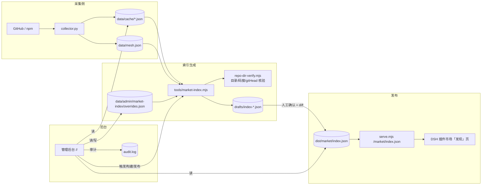
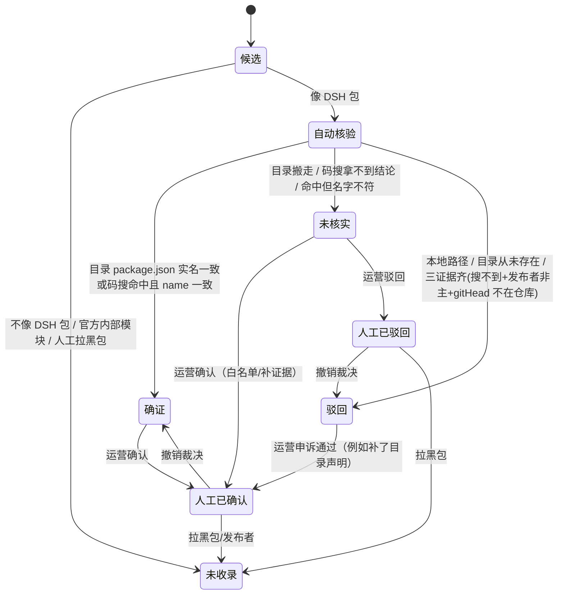
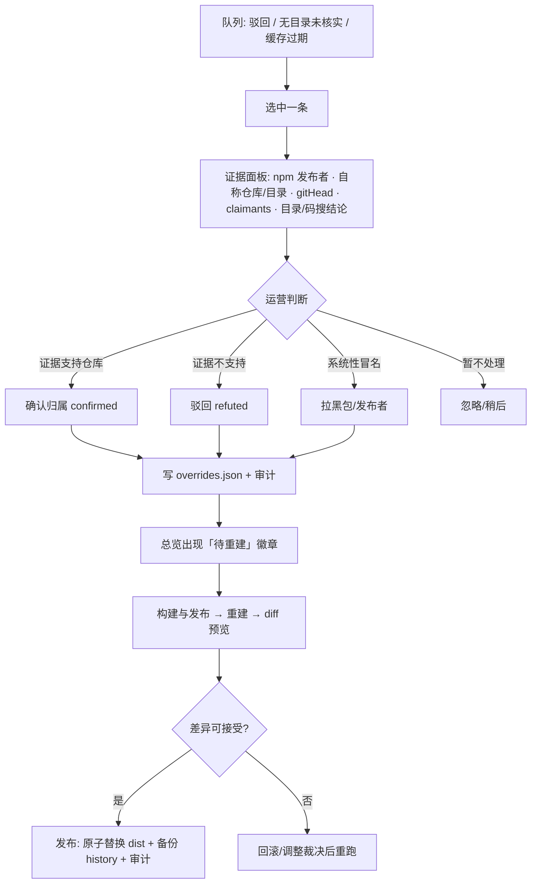
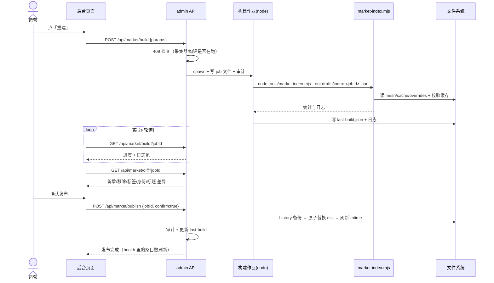
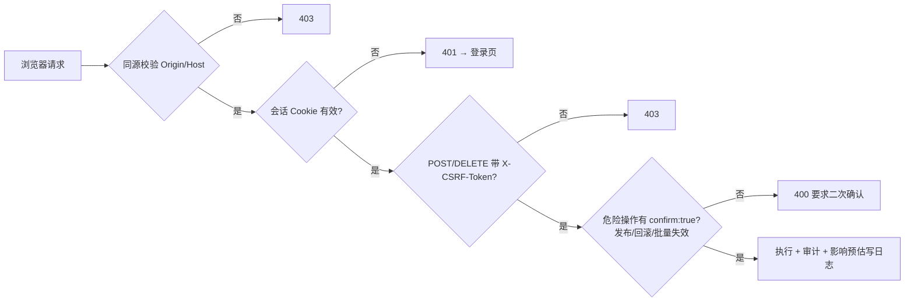

# 索引源管理后台 · 设计稿

> 一句话：在现有后台里加一个「索引源」分区，把 `/market/index.json` 的**生成 → 核验 → 人工裁决 → 差异预览 → 发布 → 回滚**
> 做成可观测、可干预、可审计的闭环。不是第二个服务：仍然长在 `tools/serve.mjs` 同一进程、同一端口、同一套登录/CSRF/审计里。

---

## 1. 为什么需要

索引源现在是一条**全自动、无观测、无出口**的流水线：

```
采集器 → data/cache/{npm-downloads,npm-search,npm-packages,npm-registry}.json → tools/market-index.mjs → dist/market/index.json → DSH「发现」页
```

它能跑，但运营者看不到也管不了：

| 今天的问题 | 后果（真实发生过） |
|---|---|
| 归属核验只有代码里的规则，没有可视化 | 6 个 `dsh-ab-*` + 1 个 `@szx-a` 包冒用官方仓库，线上挂了 1 个月没人发现 |
| 驳回/未核实结论没有人工出口 | 想纠正一条错判，只能改代码或手改 JSON |
| 没有发布环节 | 生成即上线，错了只能从备份文件里捞 |
| 校验缓存/配额是黑盒 | 不知道 code search 剩多少、哪些条目是缓存结论、多久过期 |
| 没有变更预览 | 重建一次索引，谁进来了、谁掉了、谁的作者/星标变了，全靠 diff 两个 8MB JSON |
| 审计只有「名单/共鸣」 | 索引侧的任何动作都没有留痕 |

---

## 2. 定位与边界

**做**：
- 索引源专用的**只读监控 + 人工干预 + 发布闸门**；
- 复用现有后台的认证、CSRF、审计、作业、日志白名单机制；
- 人工裁决以**叠加层（overrides）**形式存在，不修改采集器缓存、不修改生成器代码。

**不做**：
- 不新增端口/进程/独立服务；
- 不把 GitHub Token、npm Token 暴露给浏览器；
- 不提供任意命令执行、任意路径读写、任意正则；
- 不自动改写上游缓存（`data/cache/*` 只读；只有「失效重查」按钮会删除 `repo-dirs.json` 的对应 key）；
- 默认**不自动发布**（P0 阶段必须人工点「发布」）。

---

## 3. 信息架构

现有后台 6 个标签页（状态 / 数据 / 工作流 / 名单 / 共鸣 / 审计）不动，新增一个顶级标签 **「索引源」**，
进入后是二级标签（页面内切换，URL hash 记位置）：

```
┌ 插件生态图 · 管理后台 ────────────────────────────────────────────────┐
│ 状态  数据  工作流  名单  共鸣  索引源●  审计            采集圆环 12:34 60%  │
├ 索引源 ──────────────────────────────────────────────────────────────┤
│ [总览] [复核台 17] [条目库] [校验缓存] [名单] [构建与发布] [配额]        │
│                                                                      │
│  ┌ 总览 ───────────────────────────────────────────────────────────┐  │
│  │ 条目 7725    确证 6285    待确认 1440    驳回 35   无目录待核 8   │  │
│  │ (数字卡，点进对应筛选)                                            │  │
│  ├ 索引健康 ───────────────────────────────────────────────────────┤  │
│  │ dist 生成于 22:41 · 落后 mesh 0 分钟 · 待发布草稿：无              │  │
│  │ 最近构建：成功 3m12s · 确证 +12 / 驳回 +2 / 移除 0                 │  │
│  ├ 待处理队列 ─────────────────────────────────────────────────────┤  │
│  │ ● 驳回 9 条待复核   ● 无目录未核实 8 条   ● 缓存过期 12 条        │  │
│  ├ 配额 ───────────────────────────────────────────────────────────┤  │
│  │ GitHub core 4210/5000 · search 7/10 每分钟 · npm 缓存 98% 新鲜    │  │
│  └──────────────────────────────────────────────────────────────────┘  │
└──────────────────────────────────────────────────────────────────────┘
```

### 3.1 七个页面

| # | 页面 | 定位 | 核心内容 |
|---|---|---|---|
| 1 | **总览** | 一屏判断今天要不要动手 | 数字卡（确证/待确认/驳回/无目录）、索引健康（dist 与 mesh/cache 的时间差、是否落后、草稿状态）、最近构建结果、待处理队列入口、配额条 |
| 2 | **复核台** | 人工裁决工作台 | 左：队列（驳回 / 无目录未核实 / 缓存过期 / 人工已裁决）；右：证据面板（npm 发布者、自称仓库与目录、gitHead、claimants、目录校验结论、code search 命中、最终判定）+ 决策按钮（确认 / 驳回 / 拉黑包 / 拉黑发布者 / 忽略）+ 影响预估 |
| 3 | **条目库** | 全量检索 | 7725 条的表格：包名/标题、当前判定、标签、作者、仓库、星标、下载、版本、安装 spec；筛选（判定/标签/仓库/发布者/星标段/是否人工裁决）；点开单条详情 |
| 4 | **校验缓存** | 证据缓存可视化 | `repo-dirs.json` 统计（verified / missing / moved / local / absent / nodir / error）、TTL 分布、按仓库/包名/状态筛选；「单条重查」「批量失效」；缓存文件大小与最后写入 |
| 5 | **名单** | 规则出口 | 包名黑名单（不收录）、发布者黑名单（永不外借身份）、仓库名单（该仓库的包一律只算未核实，除白名单）、白名单（允许无目录借用）；每条附影响预估（会影响多少条、点应用后少多少） |
| 6 | **构建与发布** | 发布闸门 | 触发重建（可选 `--no-codesearch` / `--limit` / `--seed`）、实时日志尾、**差异预览**（新增/移除/标签变化/身份变化/标题变化）、发布、回滚到最近 N 个版本 |
| 7 | **配额** | 预算可见 | GitHub core/search 剩余与重置时间、npm 缓存新鲜度、code search 已用/预算、目录校验请求数、本轮失败数 |

---

## 4. 数据模型

全部落在 `data/admin/`（现有后台同目录，均已不进 git）：

```
data/admin/
├── config.json                     # 现有：白名单/别名组等
├── ecosystem.json                  # 现有：共鸣清单
├── audit.log                       # 现有：审计（追加）
├── job.json                        # 现有：采集/重建作业
├── logs/                           # 现有：apply-*.log
└── market-index/                   # 新增
    ├── overrides.json              # 人工裁决 + 名单（唯一写入的配置文件）
    ├── last-build.json             # 最近一次构建的元数据（参数/耗时/统计/产物 hash）
    ├── drafts/                     # 构建草稿：index-<jobId>.json（待发布）
    └── history/                    # 已发布快照：index-<ts>.json + nodes-<ts>.json（保留最近 10 个）
```

### 4.1 `overrides.json`（版本化、可回滚、带 .bak）

```jsonc
{
  "version": 1,
  "entries": {
    // 按 npm 包名裁决；生成器读它时的优先级最高
    "dsh-market-plus": {
      "decision": "refuted",            // confirmed | refuted | unverified
      "reason": "仓库无此包 + 发布者非仓库主 + gitHead 不在仓库",
      "at": "2026-10-23T14:20:00Z",
      "source": "manual"
    }
  },
  "lists": {
    "blacklistPackages": ["@chatcode/cco-market"],   // 直接不收录
    "blacklistPublishers": ["owltechcode"],          // 该发布者的包：不借仓库身份（等同 refuted 的展示效果）
    "blacklistRepos": [],                            // 该仓库的包：一律只算未核实（防止借大仓库名）
    "whitelistRepos": ["zhu1090093659/dsh-web"]      // 例外：允许该仓库在无目录时按「已确证」展示
  }
}
```

写入规则：改前留 `.bak`（只留一份）、原子写、每笔写审计；单文件上限 512KB；包名/发布者/仓库 id 走现有校验函数（`validOwner` / `validRepoId` / npm 包名正则）。

### 4.2 判定优先级（生成器里唯一的合并点）

```
人工 overrides  >  校验缓存（repo-dirs.json 的新结论）  >  自动规则（resolveOwner + gitHead 证据）
```

- 人工 `confirmed`：跳过网络校验，直接按确证展示（仍写审计，标注"人工确证"）；
- 人工 `refuted`：即使在缓存里是 confirmed，也按驳回展示（脱掉标题/作者/星标）；
- 人工 `unverified`：强制只显示「作者待确认」，不借身份；
- 黑名单包：生成器 `skipReasons` 记「人工拉黑」，根本不进索引；
- 发布者/仓库名单：在 `decideEntryAttribution` 之后、组装之前统一降级/升级。

---

## 5. 接口设计

沿用现有多租户前缀 `/<ADMIN_PATH>/`；所有写操作要 CSRF Header + 同源校验；响应一律 `no-store`。
新增路由挂在现有 `createAdmin` 的 `api/` 分派里（建议独立模块 `tools/market-admin.mjs` 导出 `createMarketAdmin({ ROOT, api, audit, sendJson })`）。

### 5.1 只读

| 方法 | 路径 | 说明 |
|---|---|---|
| GET | `/api/market/overview` | 数字卡 + 健康度 + 队列计数 + 配额摘要 |
| GET | `/api/market/plugins?q=&state=&label=&repo=&page=&size=` | 条目库分页；服务端合并 dist + 缓存 + overrides 给出"当前判定/证据摘要" |
| GET | `/api/market/plugin?name=` | 单条详情：npm 元数据、claimants、目录/码搜证据、判定历史、安装 spec |
| GET | `/api/market/queue?type=refuted\|nodir\|stale\|manual&page=` | 复核队列 |
| GET | `/api/market/cache?state=&q=&page=` | 校验缓存分页 + 统计 + 文件信息 |
| GET | `/api/market/lists` | 名单 + 影响预估（复用现有"加了他会少几个"的口径） |
| GET | `/api/market/build?jobId=` | 构建状态/日志尾/统计 |
| GET | `/api/market/diff?jobId=` | 草稿 vs 线上 dist 的差异（见 §7.3） |
| GET | `/api/market/history` | 已发布版本列表（时间/hash/条目数/统计） |
| GET | `/api/market/quota` | 配额快照（只返回数字，不返回 token） |

### 5.2 写操作（全部审计）

| 方法 | 路径 | 说明 |
|---|---|---|
| POST | `/api/market/decision` | `{name, decision:"confirmed"\|"refuted"\|"unverified", reason?}`；返回影响预估 |
| DELETE | `/api/market/decision?name=` | 撤销人工裁决 |
| GET/POST | `/api/market/lists` | 名单增删（`{action:"add"\|"remove", kind:"package"\|"publisher"\|"repo", value, note?}`） |
| POST | `/api/market/cache/refresh` | `{keys:[...]}` 或 `{state:"error"\|"nodir"\|"all"}`；异步作业，复用现有 job 轮询 |
| POST | `/api/market/build` | `{dryRun?:true, noCodeSearch?:false, limit?:20000, seed?:1}`；异步 spawn node，写 `drafts/index-<jobId>.json` |
| POST | `/api/market/publish` | `{jobId, confirm:true}`；原子替换 dist（先备份到 history） |
| POST | `/api/market/rollback` | `{ts, confirm:true}`；从 history 恢复 |
| GET | `/api/market/logs` / `/api/market/log?name=` | 构建/校验日志（白名单：`market-index-*.log`、`market-verify-*.log`） |

错误口径：`400` 参数、`401/403` 会话/CSRF、`404` 不存在、`409` 构建或采集正在进行（同一份缓存不能被两处写）、`429` 限速。

---

## 6. 流程图

### 6.1 系统数据流（后台在哪一环）



### 6.2 单条归属判定：自动 → 人工（状态机）



### 6.3 人工复核流程（复核台）



### 6.4 重建与发布（时序）



### 6.5 权限与安全（写操作闸门）



---

## 7. 关键机制

### 7.1 影响预估（每条裁决都给"会变什么"）

- 只影响 1 条：`"这条会从「dsh-market ★8.4k」变成「包名 + 下载量 + 作者待确认」"`；
- 拉黑发布者：`"该发布者当前 4 条：3 条会脱身份，1 条本来就是确证（不受影响）"`；
- 拉黑仓库：`"该仓库当前 2 条：都会降为未核实"`；
- 包不在索引里：直说 `"当前不在索引，裁决会保存，下次出现时生效"`（与现有名单预估同风格）。

### 7.2 校验缓存的运营动作

- 单条重查：删 `repo-dirs.json` 对应 key → 下次构建重跑（也可立即触发只读校验作业）；
- 批量失效：按 state（error/nodir）或按仓库前缀；
- 缓存健康：过期条目数、最早/最晚 at、文件大小；超过阈值（如 5000 条 / 2MB）提示"该清理了"（生成器已有 90 天自动清理）。

### 7.3 diff 预览（发布前必须看）

对比"草稿 JSON" vs "线上 dist JSON"，按包名对齐，输出五组：

| 组 | 说明 |
|---|---|
| 新增 | 新出现的包（附判定与原因） |
| 移除 | 从索引消失的包（附 skipReasons：人工拉黑 / 不再是 DSH 包 / 出错） |
| 标签变化 | `owner-unverified` / `subdir-package` / `recent-release` 等增减 |
| 身份变化 | author / repository / stars 从 A → B（冒名修复应该都在这里） |
| 标题/描述变化 | title（=包名政策）与 description 前缀 |

界面上以 4 个数字卡 + 分组列表呈现，默认只展开"身份变化"和"移除"（风险最高）。

### 7.4 发布与回滚

- 发布 = `history/index-<ts>.json` 备份 → `rename(draft, dist/market/index.json)` → 同时写 `index-nodes.json` → 审计；
- 保留最近 10 版；回滚选历史版本 → 先 diff → confirm → 原子恢复；
- 发布后 `/api/health` 与首页「索引源」计数自动刷新（serve 按 mtime 读，无需重启）。

### 7.5 配额与预算

- GitHub core/search 剩余：后台进程内缓存 60s，用一次 `GET /rate_limit` 拿（只返回数字）；
- code search：生成器日志里已有"无目录代码检索 N 条"，后台解析 `last-build.json` 汇总；
- npm 缓存新鲜度：`npm-registry.json.updatedAt` 与 24h TTL 对比；
- 超阈值提示：core < 500、search 剩余 0、npm 缓存 > 80% 过期 → 总览黄条。

---

## 8. 代码改造点（按现有结构挂）

| 层 | 文件 | 改动 |
|---|---|---|
| 服务端 | `tools/market-admin.mjs`（新） | `createMarketAdmin({...})`：路由、参数校验、overrides 读写、任务 spawn、diff、发布/回滚 |
| 服务端 | `tools/admin.mjs` | `createAdmin` 里挂 `child = createMarketAdmin(...)`，在 `api/` 分派最前面转发 `market/*`；无 `ADMIN_PATH` 时整体仍关闭 |
| 服务端 | `tools/admin-config.mjs` | 新增路径常量：`MARKET_DIR / MARKET_OVERRIDES / MARKET_JOBS / MARKET_DRAFT / MARKET_HISTORY`；新增 `readMarketOverrides` 校验 |
| 生成器 | `tools/market-index.mjs` | 读 overrides：裁决覆盖 + 名单过滤 + 黑名单包跳过；新增 `--out` 草稿模式与 `last-build.json` 统计输出（含 diff 摘要） |
| 核验 | `tools/repo-dir-verify.mjs` | 只加一个 `invalidateCacheKeys(file, keys)` 供「失效重查」用；判定规则不动 |
| 前端 | `admin/index.html` | 标签栏新增「索引源」按钮 + 二级 tab 容器 |
| 前端 | `admin/app.js` 或 `admin/market.js`（新） | 7 个页面渲染、轮询、diff 展示、二次确认；沿用现有 `el()`/`card()`/`section()` 组件与配色变量 |
| 前端 | `admin/admin.css` | 复用面板族/凹槽族；只加数字卡、队列列表、diff 三列表格 |
| 测试 | `tests/market-admin.test.mjs`（新） | overrides 优先级、名单影响、diff 计算、发布/回滚原子性、CSRF/同源、路径穿越 404 |
| 测试 | `tests/market-admin.dom.test.mjs`（新，P1） | 复核台决策按钮、diff 渲染、二次确认 |

**关键约束**：所有 `data/cache/*` 只读；`dist/market/*` 只在「发布/回滚」时写；`overrides.json` 是唯一人工配置文件。

---

## 9. 实施分期

### 实现状态（2026-10-23）

**P0 已落地**（未提交、未部署）：

| 文件 | 状态 |
|---|---|
| `tools/market-overrides.mjs`（新） | overrides 读写/规范化/原子写/.bak；生成器与后台共用 |
| `tools/market-admin.mjs`（新） | overview/plugins/plugin/queue/cache/lists/decision/build/diff/publish/history/rollback/logs |
| `tools/market-index.mjs` | 读 overrides：人工裁决优先级、包名拉黑跳过、发布者/仓库名单降级/升级；`--overrides` 参数 + 人工介入日志 |
| `tools/admin.mjs` | 挂载 `api/market/*`、新增 `market.js` 静态资源 |
| `admin/index.html` / `app.js` / `market.js`（新） / `admin.css` | 「索引源」标签页 + 总览/复核台/构建发布三页 |
| `tests/market-admin.test.mjs`（新） | 8 个用例：名单规范化/优先级/diff/发布回滚/并发保护 |

已验证：341 个 JS 测试全过；临时服务冒烟（登录 → overview → queue → 裁决写盘 → 撤销 → 采集器在跑时构建返回 409）通过。
**P1 未做**：条目库/缓存/名单/配额的独立页面（接口已有 cache/lists），危险操作二次确认弹窗正在用 `window.confirm`。

### P0（一天可验收）：只读 + 裁决 + 手动发布
1. `overrides.json` 读写模块 + 生成器消费（优先级）；
2. `overview / plugins / queue / plugin / build / diff / publish` 接口；
3. 「总览」「复核台」「构建与发布」三个页面；
4. 重建作业（spawn 现有脚本到草稿）+ diff + 发布/回滚；
5. 测试：优先级、diff、发布原子性、审计。

验收：把 `dsh-market-plus` 在后台点「驳回」→ 总览出现待重建 → 重建 → diff 显示 1 条身份变化 → 发布 → `/market/index.json` 里该条无 title/author/repo；回滚可恢复。

### P1（半天）：条目库 + 校验缓存 + 名单 + 配额
- 全量表格筛选、缓存分页/失效、名单与影响预估、配额条、日志查看。

### P2：自动化与报表
- 定时重建 + **自动发布仅当 diff 通过白名单策略**（如"只允许身份变化 ≤ 阈值且无新增驳回"）；
- 版本对比/导出 CSV/周报表；webhook 通知（构建失败、驳回数突增）。

---

## 10. 风险与回滚

| 风险 | 缓解 |
|---|---|
| 后台把索引改错导致市场页异常 | 发布前强制 diff；history 保留 10 版；一键回滚；发布是原子 rename |
| 与采集器/生成器并发写同一缓存 | 构建作业 409：detect `collectorBusy()` 或已有 job running；生成器本身写 `data/cache/npm-registry.json` 是原子写 |
| overrides 被写坏 | 每次写前 `.bak`；读时校验结构，坏文件按空表处理（与现有 config 同口径） |
| 误操作不可逆 | 危险操作 `confirm:true`；全部审计（IP/动作/详情/前后差异摘要） |
| 配额被后台耗尽 | 「失效重查」按 key 限 200 条/次；code search 复用生成器限速；配额 <500 时按钮置灰 |
| 后台拖慢公共站点 | 所有作业异步 spawn；明细查询分页；diff 在作业结束时算好存文件，不每次重算 |

回滚步骤：`history/index-<ts>.json` 拷回 `dist/market/index.json` → 写 `index-nodes.json` → 审计 → health 刷新。配置回滚：`overrides.json.bak`。

---

## 11. 待你拍板的点

1. **人工裁决的边界**：`confirmed` 是否允许"绕过网络证据"（我建议允许，但审计里标"人工确证"，且界面上永久显示"人工"徽章）？
2. **是否自动发布**：P0 建议全手动；P2 的自动发布策略白名单（只允许哪些 diff）要不要做？
3. **名单粒度**：需要不需要"仓库 × 包名"二维黑名单（现在设计是发布者/仓库/包名三张一维名单）？
4. **历史版本保留数**：默认 10 个（每个约 6MB，合计 60MB）够不够？
5. 后台是否需要**导出**（CSV / 只读 JSON）给外部审计？

### 多重校验（2026-10-23 追加，已实现）

在原有「组合包声明 → 归属认领 → 目录实名/历史/code search → 人工裁决」之上又加了三层，并在「索引源 → 工作流」页以 L1~L9 表格展示每层覆盖与拦截：

| 层 | 新增校验 | 实现要点 |
|---|---|---|
| L4 | 目录 package.json 的 repository 必须指向同一仓库 | 复用 L3 的同一次 GitHub 请求，零额外成本；monorepo 相对路径忽略；不一致 → 未核实 |
| L7 | **npm 发布溯源（SLSA provenance）** | GET registry.npmjs.org/-/npm/v1/attestations/<pkg>@<ver>；解析 SLSA buildDefinition 的仓库/commit；溯源仓库==声称仓库 → 强制确证并挂 provenance-verified；不一致 → 强制驳回；无溯源=中性；只查声称 ★≥100 的仓库，结论按 pkg@version 缓存 30 天 |
| L9 | **索引不变量自检** | 包名唯一、title=包名、版本严格 semver、publishTimestamp 正整数、source=npm、标签已声明、repository/icon/keywords 格式；违规写入 build-stats.selfCheck 并让构建退出码非 0 |

生成器参数：--no-provenance / --provenance-min-stars（默认 100）/ --provenance-cache（默认 data/cache/provenance.json）/ --provenance-concurrency（默认 3）。

### 标签开关（2026-10-23 追加，已实现）

后台「索引源 → 标签」页可以逐个开关分类胶囊（如隐藏「作者待确认」）：

- 清单来自共享的 tools/market-labels.mjs（含中文名），接口 GET/POST /api/market/labels；
- 开关只写 data/admin/market-index/overrides.json 的 labels.hidden；
- 生成器据此从条目 metadata.labels 与索引级 metadata.labels 声明里同时移除该标签
  （DSH 市场里就不再显示这枚胶囊/筛选项），归属判定本身不变；
- 隐藏 owner-unverified 时，归属自检不再要求"无作者名必须挂该标签"（显式隐藏不是把猜测当事实），
  统计日志改用内部判定计数，数字不会因为标签被隐藏而消失；
- 保存后需要「构建与发布 → 重建 → 发布」才进入线上索引。
